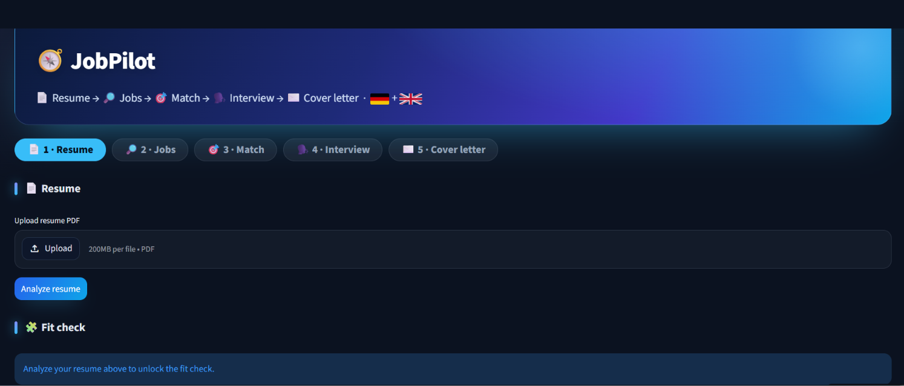

<div align="center">

# 🧭 JobPilot

**From Resume to Interview — Tailored for the Heilbronn & Baden-Württemberg Corridor.**  
*Bilingual (German & English) • Powered by Groq*

[](https://www.python.org/)
[](https://groq.com)
[](https://streamlit.io)
[](#)

<br />



</div>

JobPilot is an end-to-end career copilot designed for job seekers in the Heilbronn and Baden-Württemberg region. It parses your PDF resume, discovers live listings directly from Germany's official **Bundesagentur für Arbeit** database, runs an instant Fit Check on any job description (scoring CV-vs-JD alignment, identifying skill gaps, and generating targeted learning plans), and prepares tailored interview strategies and cover letters.


## 🎯 Features

| Step | Feature | Interface |
|:---:|---|---|
| 1 | **Resume Parser** — PDF → structured profile (DE + EN) | `resume_app.py` |
| 2 | **Job Search** — live listings in the Heilbronn & Baden-Württemberg corridor | `jobs_app.py` |
| 3 | **Smart Match** — rank jobs against the candidate profile with DE/EN rationale | Library (`resume_jobs.match`) |
| 4 | **Interview Prep** — bilingual interview questions, answer outlines, and gap analysis | Library (`resume_jobs.interview`) |
| 5 | **Cover Letter** — tailored *Anschreiben* (DE) + cover letter (EN) | Library (`resume_jobs.cover_letter`) |
| 6 | **Fit Check** — paste a JD → fit score, matched/missing skills, and targeted learning plan | `streamlit_app.py` (`resume_jobs.jd_fit`) |

---

## 🚀 Quick Start

### 1. Clone & Install

```bash
git clone git@github.com:jiyan-0525/JobPilot.git
cd JobPilot

python -m venv .venv
source .venv/bin/activate    # On Windows: .venv\Scripts\activate
pip install -r requirements.txt
```

### 2. Configure Environment

Create a `.env` file in the project root:

```bash
cp .env.example .env   # or create .env directly
```

```ini
GROQ_API_KEY=your_key_from_https://console.groq.com/keys
GROQ_MODEL=openai/gpt-oss-120b        # optional; defaults to openai/gpt-oss-120b
```

> **Note**: Job search connects to the public Bundesagentur für Arbeit API and does not require an external key.

### 3. Launch the Application

```bash
# Recommended: Launch the integrated all-in-one UI
streamlit run streamlit_app.py

# Alternatively, launch standalone modules:
streamlit run resume_app.py    # Resume parser tab
streamlit run jobs_app.py      # Job search tab
```

### 4. Run Offline Tests

```bash
pytest tests/
```

---

## ⚙️ Configuration & APIs

- **Groq AI Engine** → Ultra-fast OpenAI-compatible inference with open-weights models.
- **`GROQ_MODEL` Override** → Set to lighter models (e.g. `openai/gpt-oss-20b`) to bypass daily token caps on the free tier without modifying code.
- **Bundesagentur für Arbeit Jobsuche API** → Official German employment service API (`X-API-Key: jobboerse-jobsuche`), free and public with no registration required.
- **Arbeitnow API** → Integrated client available as a secondary job data source.

---

## 🛠️ Tech Stack

- **AI Engine**: Groq + GPT-OSS 120B (`openai/gpt-oss-120b`)
- **Web UI**: Streamlit
- **PDF Extraction**: `pypdf`
- **Job APIs**: Bundesagentur für Arbeit Jobsuche API & Arbeitnow
- **Testing**: pytest (46 offline tests, no API key or network required)
- **CI/CD**: GitHub Actions
- **Python**: 3.10+

---

## 🏗️ Project Structure

```
JobPilot/
├── streamlit_app.py        # All-in-one UI: workflow tabs + Fit Check
├── resume_app.py           # Standalone: resume → profile
├── jobs_app.py             # Standalone: job search corridor
├── resume_jobs/
│   ├── llm.py              # Shared Groq client (lazy initialization)
│   ├── schema.py           # Profile schema & normalization
│   ├── resume.py           # PDF extraction & profile parsing
│   ├── jobs.py             # Arbeitsagentur API client (search + details)
│   ├── arbeitnow.py        # Arbeitnow API client (secondary source)
│   ├── step.py             # Step framing (role / task / context)
│   ├── render.py           # Profile & job block rendering
│   ├── match.py            # Step 3: rank_jobs()
│   ├── jd_fit.py           # Step 6: analyze_fit() & CV-vs-JD scoring
│   ├── interview.py        # Step 4: prepare_interview()
│   ├── learning_plan.py    # build_learning_plan() for skill gaps
│   └── store.py            # Local JSON persistence (profiles, job caches)
├── rag.py                  # Question bank RAG module
├── tests/                  # Complete offline test suite (46 tests)
├── requirements.txt
└── RESUME_JOBS.md          # Full design specification & API notes
```

---

## 🗺️ Roadmap & Future Work

### Completed Milestones
- [x] **Resume Parser**: PDF text extraction and structured DE/EN profile parsing
- [x] **Job Search**: Live listings for the Heilbronn & Baden-Württemberg corridor
- [x] **Smart Matching**: Profile ∩ Job Description scoring with bilingual rationale
- [x] **Interview Prep**: Role-tailored questions, answer strategies, and gap analysis
- [x] **Cover Letter**: Automated German *Anschreiben* and English cover letters
- [x] **Fit Check**: Paste any JD for fit score, missing skills, and learning plan

### Planned Enhancements
- [ ] UI toggle for Arbeitnow as an alternative job board
- [ ] Vector RAG for customized technical question banks (`rag.py`)
- [ ] One-click PDF download for generated cover letters and interview prep sheets

See [`RESUME_JOBS.md`](RESUME_JOBS.md) for architectural details, API notes, and design guidelines.
